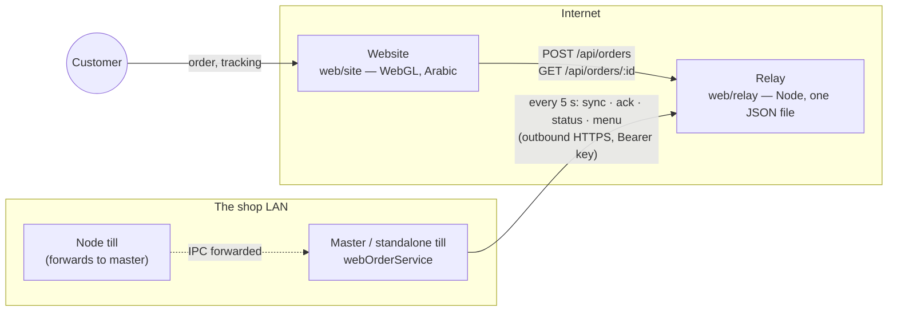
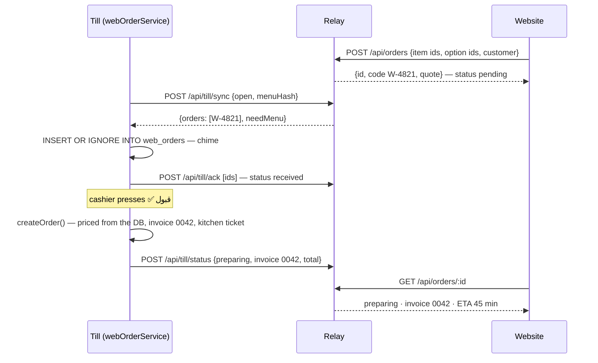

# 10 — Online Ordering (the website)

This adds a public website that takes orders and puts them on the till. It is additive:
nothing about trading at the counter changes, and a till with the feature switched off
behaves exactly as before.

## The constraint that decides the design

`01-architecture.md` puts nothing in the critical path that needs the internet, and the
till sits behind the shop's router with no public address. Both stay true. So the website
cannot hand an order to the till — **the till has to come and get it.**

The till dials out every five seconds — the same direction as a browser loading a page,
which every router already allows. No port forwarding, no dynamic DNS, nothing to
configure on the shop's network. If the internet drops, the till trades as normal; it
stops checking in, and the relay stops accepting orders within 45 seconds, so no customer
is left waiting on an order nobody can see.

## One round trip

## Decisions

**A separate inbox table, not columns on `orders`.** `web_orders` holds what the customer
*asked for*. Nothing is sold until a cashier accepts it, at which point it goes through
the ordinary `createOrder` and `web_orders.order_id` points at the invoice. Rejected and
unanswered orders therefore never reach a report. It also keeps the feature out of the
`orders` rebuild migrations in `db.ts`, which copy a fixed column list and would silently
drop anything they did not know about. `order_id` has no foreign key for the same reason
the shop-data import can replace `orders` wholesale.

**The till owns the price.** The relay quotes from the menu the till published so the
customer sees a number before sending, but the browser only ever sends ids. On accept,
`createOrder` prices every line from the database exactly as at the counter; if the owner
changed a price in between, the customer's tracking page shows the till's figure. One
extra check runs first: every chosen option must still belong to the dish. `createOrder`
quietly ignores unknown options (right for a cart built seconds ago), which for a web order
would ring a stale "large" up as a regular — so instead the cashier is stopped and told
to call the customer.

**Status is derived, never stored.** What the customer sees is computed on every sync from
the till's own records — `web_orders.status` for the inbox and takeaway steps, the
invoice's `status`/`deleted_at` for cancellations, `delivery_status` for everything after
the kitchen. The delivery board, a void or a deletion therefore update the customer
without knowing web orders exist. `synced_status` records what the relay last confirmed,
so a status that failed to send is simply re-sent next round.

| At the till | Customer sees |
|---|---|
| `web_orders.status = new` | received — بانتظار القبول |
| rejected (with reason) | rejected + the reason |
| accepted, delivery `preparing` / null | preparing — بيتقلي دلوقتي |
| delivery `pending` | ready |
| delivery `out` | on_the_way |
| delivery `delivered` | delivered |
| delivery `returned`, invoice voided or deleted | cancelled |
| takeaway `accepted` → `ready` → `collected` | preparing → ready → collected |

**Who collects.** Only a master or standalone till, only when the owner has switched it
on, only with a licence, and never on the showcase books (publishing the demo restaurant's
menu to the real website would be a disaster). A node till's IPC is forwarded to the
master like every other channel, so a web order can be accepted at any till.

**When the website takes orders.** Only while the till is checking in, the cashier has not
pressed ⏸️, and a work shift is open — between shifts there is nobody to accept anything.

## Channels

| Channel | Who | Purpose |
|---|---|---|
| `web:list` / `web:status` | any signed-in user | the inbox, and the connection state |
| `web:accept` | cashier, owner — needs an open shift | ring the order up, print, report back |
| `web:reject` | cashier, owner | decline with a reason the customer sees |
| `web:stage` | cashier, owner | takeaway: ready, collected |
| `web:setAccepting` | cashier, owner | pause / resume the website |
| `web:config:get` / `web:config:set` | owner — settings unlocked for `set` | relay URL, key, ETAs |
| `web:test` | owner | one sync now, with the real answer |
| `app:webOrdersChanged` | Main → Renderer push | new orders (chime, banner), link state |

The relay key is written to `settings` but never returned by any channel — screens only
learn whether one is set.

## Files

- `src/main/services/webOrderService.ts` — config, menu snapshot, inbox, accept/reject, sync loop
- `src/main/ipc/webOrders.ipc.ts` — the channels above, native notification
- `src/renderer/screens/cashier/WebOrdersScreen.tsx` — the inbox
- `src/renderer/screens/owner/WebOrderingSettings.tsx` — the settings tab
- `tests/web-orders.test.ts` — end-to-end against the real relay, in-process
- `web/` — the website, the relay, its tests, Dockerfile and deployment notes
